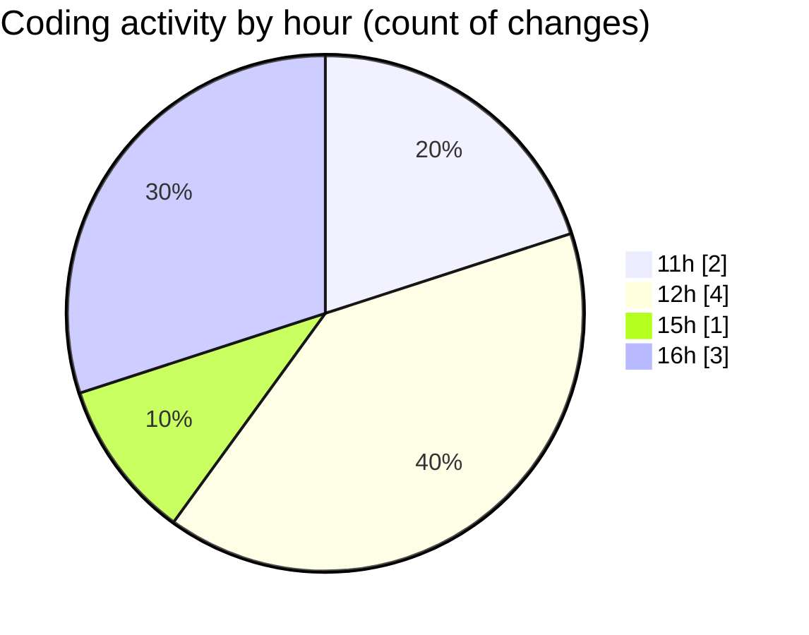

# CILApp - Activity Summary 

## Overall Statistics

| Stat                   | Value                                                             |
| ---------------------- | ----------------------------------------------------------------- |
| **Lines Added** (➕)   | 3463                                          |
| **Lines Removed** (➖) | 19                                        |
| **Net Change** (↕)    | 3444                |
| **Active Time** (⌚)   | 3 minutes |

## Modified Files
- **launch.json** (+1300, -0)
- **APM-1-1-24-guardar pdfs sms + certificados a la vex.txt** (+1, -0)
- **ProcMonitorioToMASC.java** (+917, -6)
- **MascSmsService.java** (+1245, -13)

## Visualizations

### By File Type (Lines Changed)

### By Hour (Estimated Activity Count)

> **Last Updated:** 10/15/2026, 4:32:23 PM