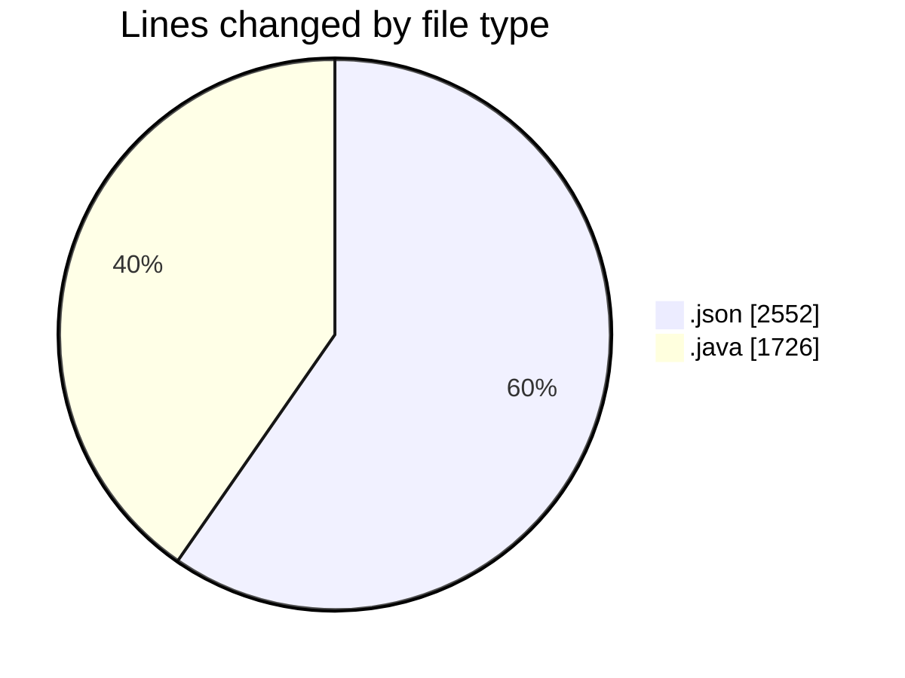
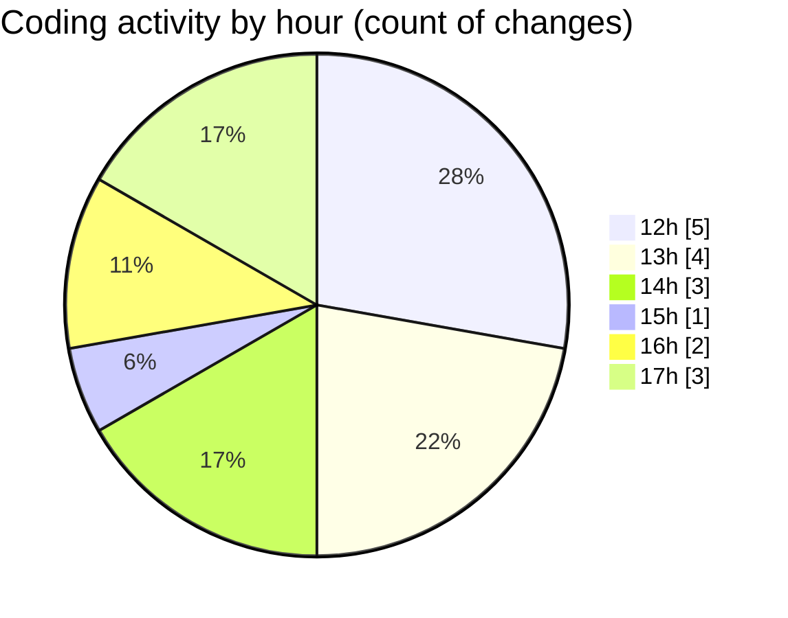

# CILApp - Activity Summary 

## Overall Statistics

| Stat                   | Value                                                             |
| ---------------------- | ----------------------------------------------------------------- |
| **Lines Added** (➕)   | 3052                                          |
| **Lines Removed** (➖) | 1226                                        |
| **Net Change** (↕)    | 1826                |
| **Active Time** (⌚)   | 10 minutes |

## Modified Files
- **launch.json** (+1330, -1222)
- **ProcesoCartasAsesoria.java** (+835, -4)
- **WsOrdersReport.java** (+51, -0)
- **CustomerComBatchClient.java** (+90, -0)
- **PanelMensajes.java** (+375, -0)
- **DatosCartaAsesoria.java** (+327, -0)
- **Constantes.java** (+44, -0)

## Visualizations

### By File Type (Lines Changed)

### By Hour (Estimated Activity Count)

> **Last Updated:** 10/20/2026, 5:36:09 PM