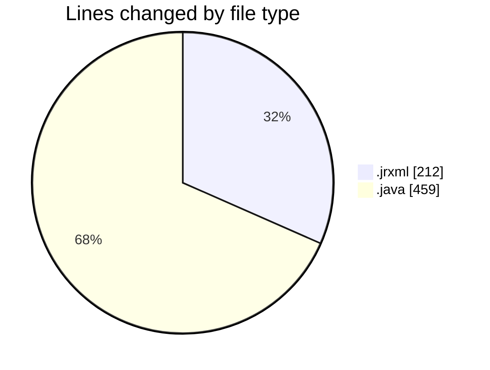
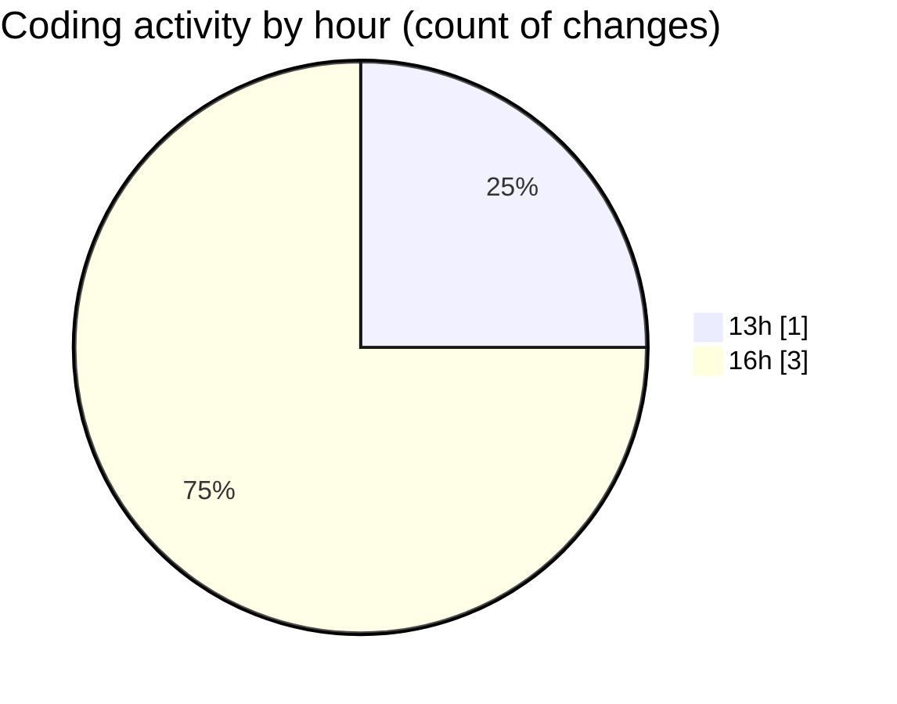

# CILReports (Workspace) - Activity Summary 

## Overall Statistics

| Stat                   | Value                                                             |
| ---------------------- | ----------------------------------------------------------------- |
| **Lines Added** (➕)   | 658                                          |
| **Lines Removed** (➖) | 13                                        |
| **Net Change** (↕)    | 645                |
| **Active Time** (⌚)   | 0 minute |

## Modified Files
- **JUDICIAL_ESCRITO.jrxml** (+199, -13)
- **JasperAsesoriaServiceImp.java** (+373, -0)
- **JasperAsesoriaRestController.java** (+86, -0)

## Visualizations

### By File Type (Lines Changed)

### By Hour (Estimated Activity Count)

> **Last Updated:** 10/20/2026, 4:44:58 PM