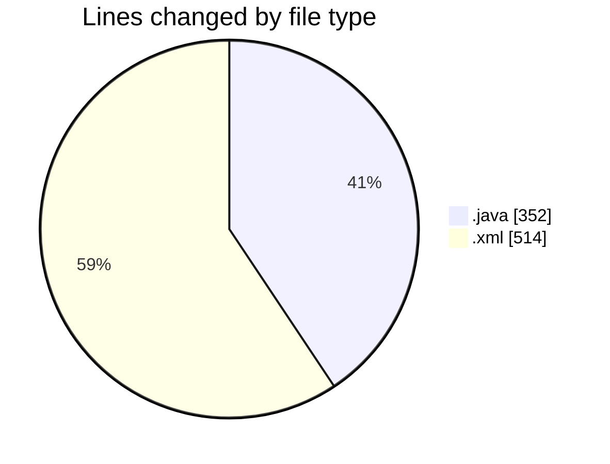
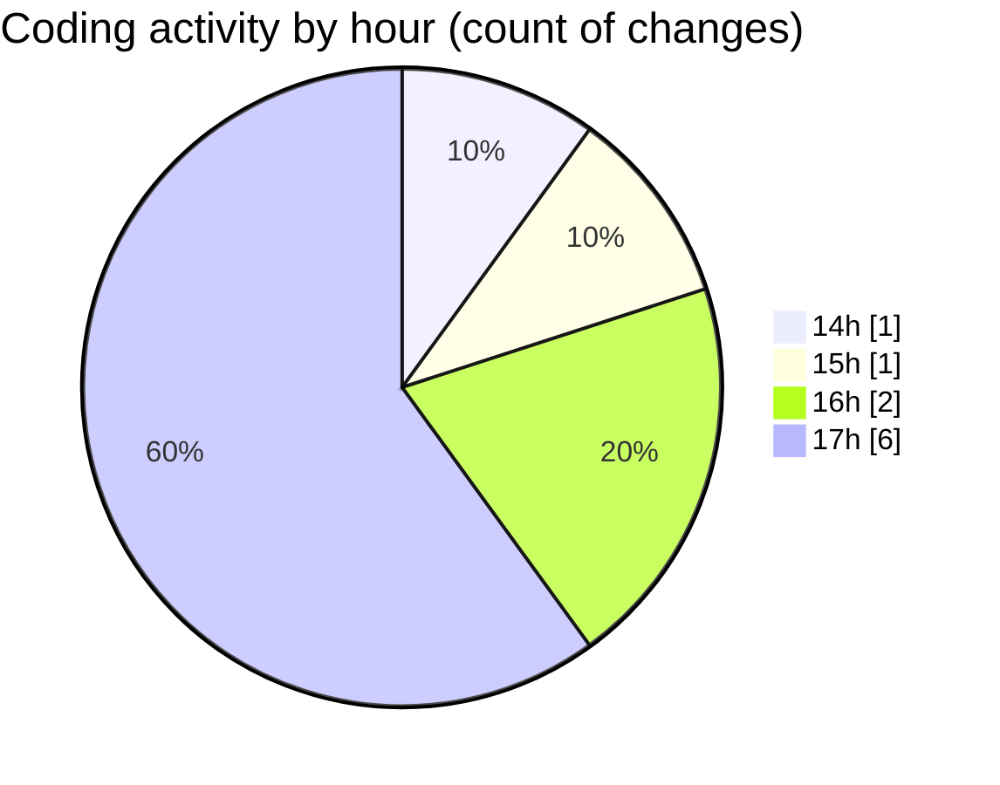

# CILReports (Workspace) - Activity Summary 

## Overall Statistics

| Stat                   | Value                                                             |
| ---------------------- | ----------------------------------------------------------------- |
| **Lines Added** (➕)   | 769                                          |
| **Lines Removed** (➖) | 97                                        |
| **Net Change** (↕)    | 672                |
| **Active Time** (⌚)   | 7 minutes |

## Modified Files
- **ConstantsJasperIF2Documentation.java** (+105, -0)
- **recentservers.xml** (+125, -0)
- **sitemanager.xml** (+107, -0)
- **JasperAsesoriaServiceImp.java** (+0, -91)
- **JasperAsesoriaRestController.java** (+0, -6)
- **AsesoriaRepository.java** (+86, -0)
- **AsesoriaSqlQueries.java** (+40, -0)
- **JasperAsesoriaService.java** (+24, -0)
- **filezilla.xml** (+282, -0)

## Visualizations

### By File Type (Lines Changed)

### By Hour (Estimated Activity Count)

> **Last Updated:** 10/26/2026, 5:22:50 PM