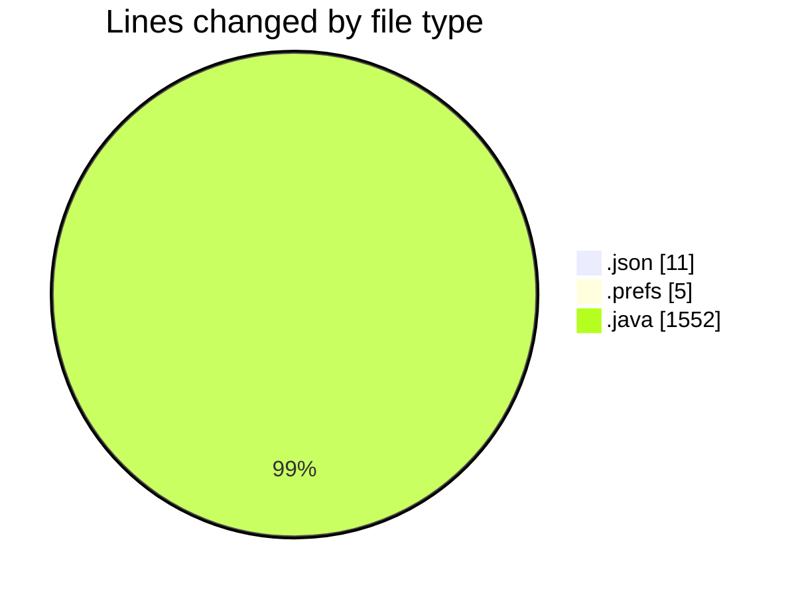
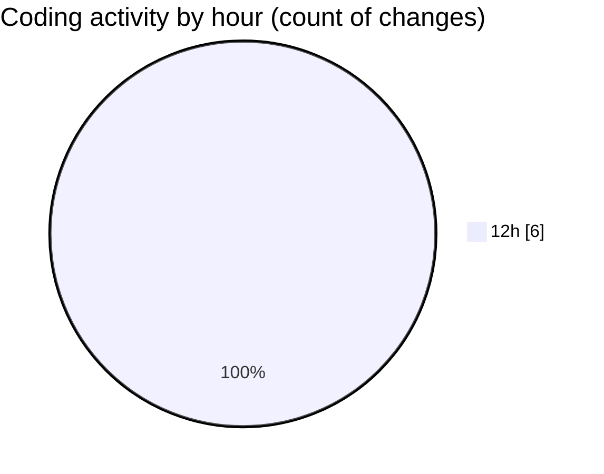

# CILReports (Workspace) - Activity Summary 

## Overall Statistics

| Stat                   | Value                                                             |
| ---------------------- | ----------------------------------------------------------------- |
| **Lines Added** (➕)   | 1564                                          |
| **Lines Removed** (➖) | 4                                        |
| **Net Change** (↕)    | 1560                |
| **Active Time** (⌚)   | 1 minute |

## Modified Files
- **settings.json** (+11, -0)
- **org.eclipse.m2e.core.prefs** (+5, -0)
- **PostVentaMetadataMapper.java** (+67, -4)
- **JasperCobrosServiceImpl.java** (+568, -0)
- **JasperRecoverServiceImpl.java** (+913, -0)

## Visualizations

### By File Type (Lines Changed)

### By Hour (Estimated Activity Count)

> **Last Updated:** 11/3/2026, 12:56:27 PM