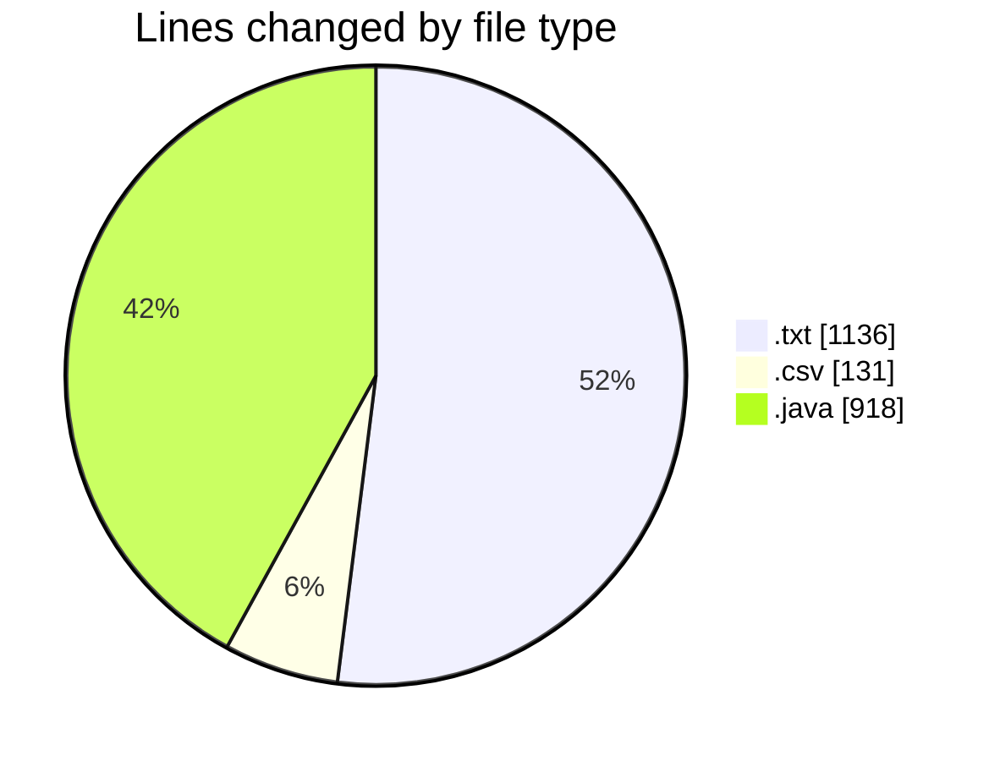
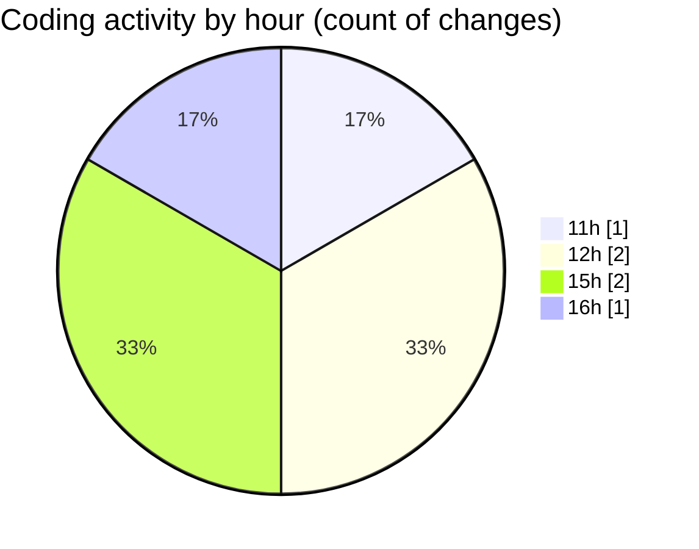

# CILApp - Activity Summary 

## Overall Statistics

| Stat                   | Value                                                             |
| ---------------------- | ----------------------------------------------------------------- |
| **Lines Added** (➕)   | 2121                                          |
| **Lines Removed** (➖) | 64                                        |
| **Net Change** (↕)    | 2057                |
| **Active Time** (⌚)   | 1 minute |

## Modified Files
- **output docpath y ejemplo de 1495 desglosado.txt** (+1136, -0)
- **_SELECT_MEDIO_PAGO_PED_COD_ARTICULO_DESC_ARTICULO_CD_TRATAMIENTO_202610061616.csv** (+67, -64)
- **ProcesoCartasAsesoria.java** (+633, -0)
- **DocPath.java** (+46, -0)
- **XmlToCobrosServiceImpl.java** (+239, -0)

## Visualizations

### By File Type (Lines Changed)

### By Hour (Estimated Activity Count)

> **Last Updated:** 11/5/2026, 4:50:20 PM