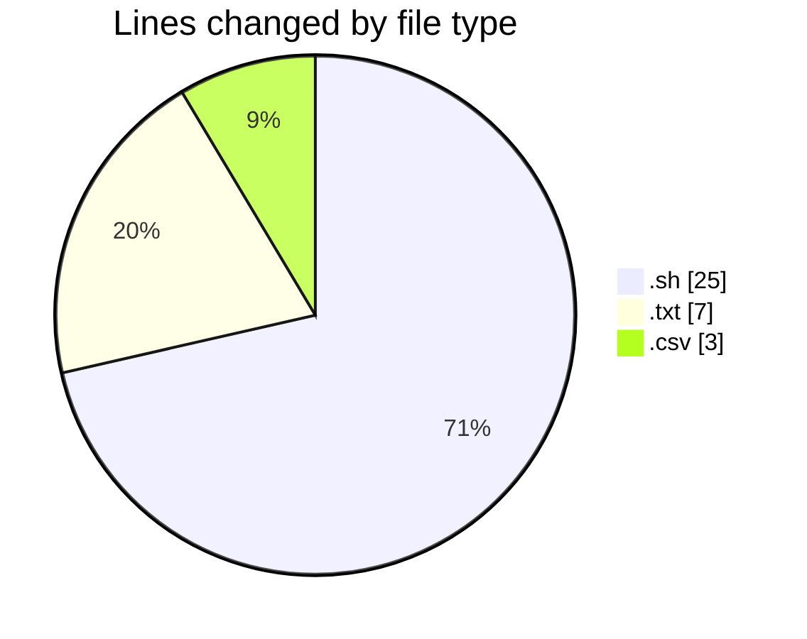
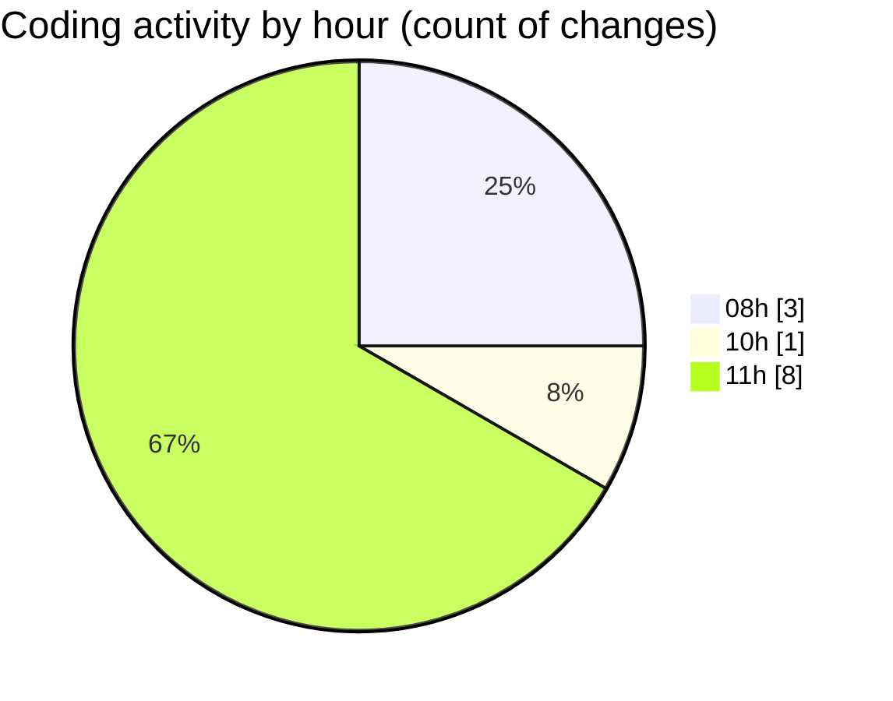

# Scripts - Activity Summary 

## Overall Statistics

| Stat                   | Value                                                             |
| ---------------------- | ----------------------------------------------------------------- |
| **Lines Added** (➕)   | 26                                          |
| **Lines Removed** (➖) | 9                                        |
| **Net Change** (↕)    | 17                |
| **Active Time** (⌚)   | 4 minutes |

## Modified Files
- **PEDIDOS_SEG_MES.sh** (+19, -6)
- **RECUP_POLONIA_2346135.txt** (+5, -2)
- **PEDIDOS_SEG_MES202610_20261112_111432.csv** (+2, -1)

## Visualizations

### By File Type (Lines Changed)

### By Hour (Estimated Activity Count)

> **Last Updated:** 11/12/2026, 11:54:45 AM