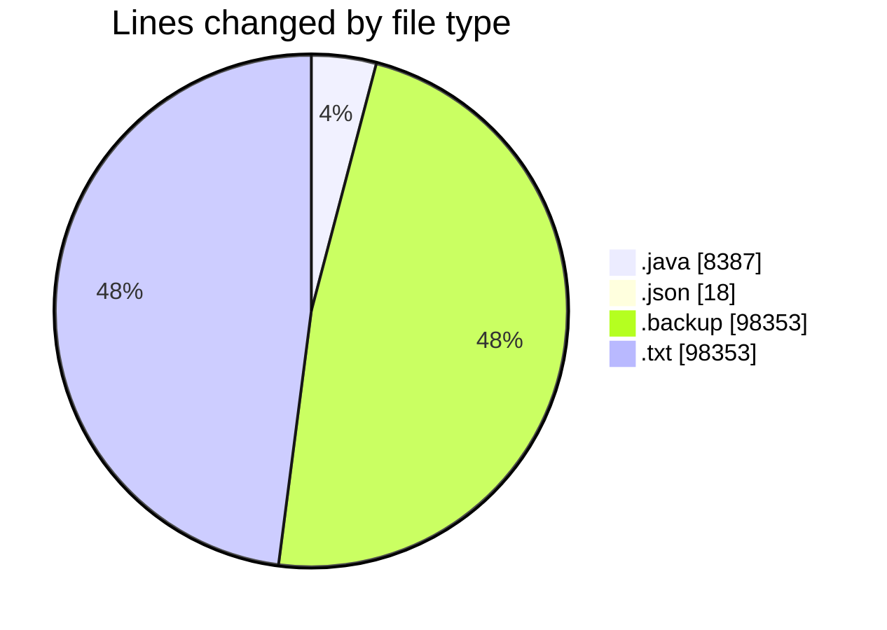
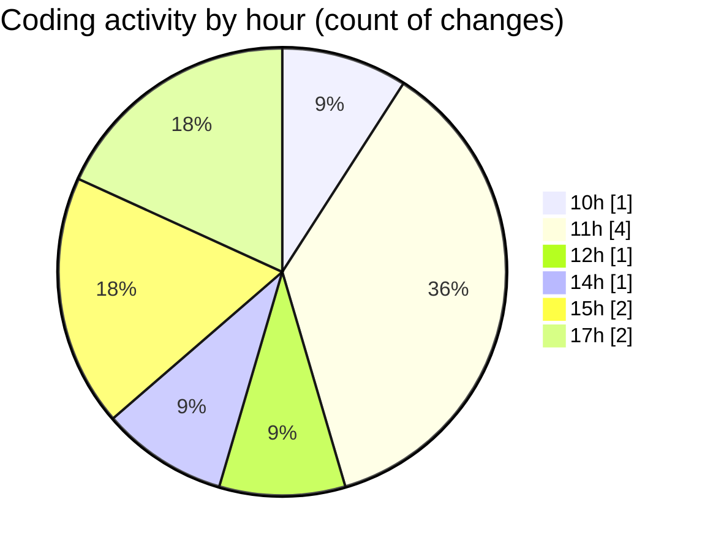

# CILApp - Activity Summary 

## Overall Statistics

| Stat                   | Value                                                             |
| ---------------------- | ----------------------------------------------------------------- |
| **Lines Added** (➕)   | 205080                                          |
| **Lines Removed** (➖) | 31                                        |
| **Net Change** (↕)    | 205049                |
| **Active Time** (⌚)   | 5 minutes |

## Modified Files
- **PresentacionMonitorios.java** (+3631, -31)
- **DocumentacionDRTV.java** (+481, -0)
- **MascSmsService.java** (+1041, -0)
- **ImprReembolsos.java** (+563, -0)
- **PanelCpPedidosMP.java** (+2640, -0)
- **launch.json** (+18, -0)
- **Cartas_Asesoria_Resto2026-11-17_2.backup** (+98353, -0)
- **Cartas_Asesoria_Abogado_Interno2026-11-17_1.txt** (+98353, -0)

## Visualizations

### By File Type (Lines Changed)

### By Hour (Estimated Activity Count)

> **Last Updated:** 11/17/2026, 5:36:21 PM