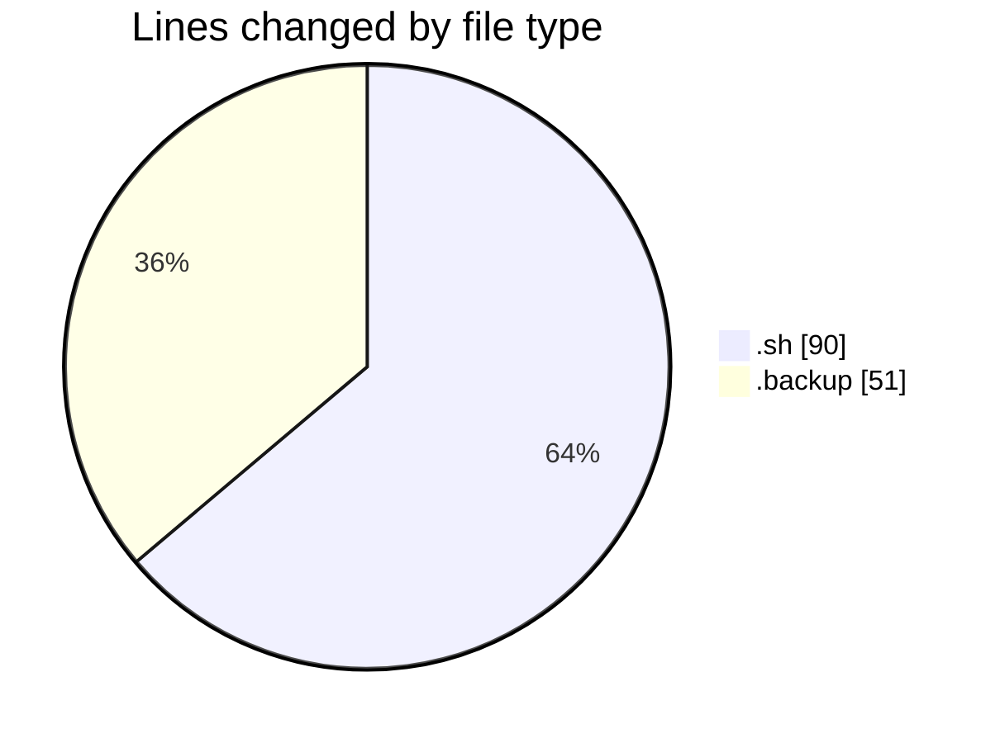
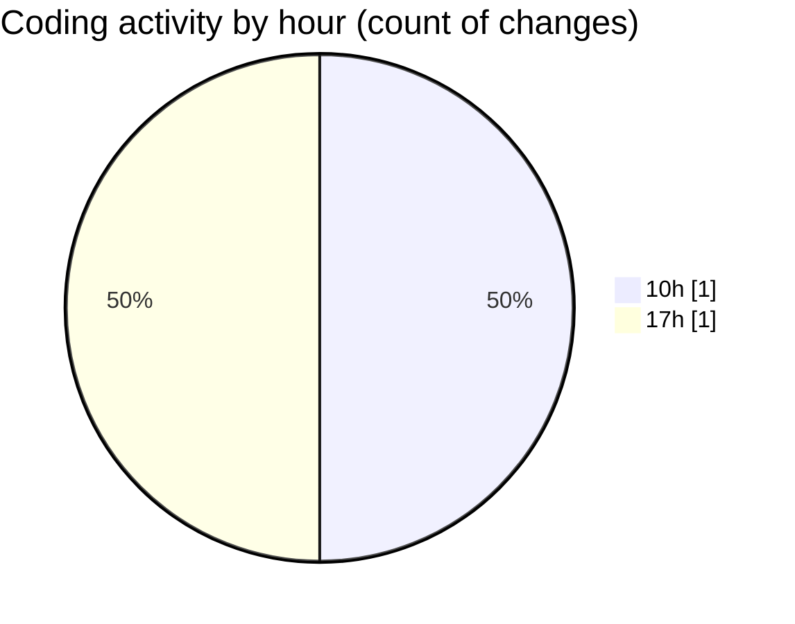

# Scripts - Activity Summary 

## Overall Statistics

| Stat                   | Value                                                             |
| ---------------------- | ----------------------------------------------------------------- |
| **Lines Added** (➕)   | 141                                          |
| **Lines Removed** (➖) | 0                                        |
| **Net Change** (↕)    | 141                |
| **Active Time** (⌚)   | 0 minute |

## Modified Files
- **FTP_ESMAD_TO_AIX_ASE.sh** (+90, -0)
- **cartas_resto_2026-11-17_2.backup** (+51, -0)

## Visualizations

### By File Type (Lines Changed)

### By Hour (Estimated Activity Count)

> **Last Updated:** 11/17/2026, 5:35:44 PM