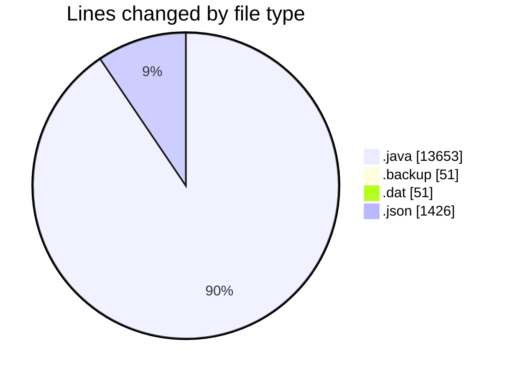
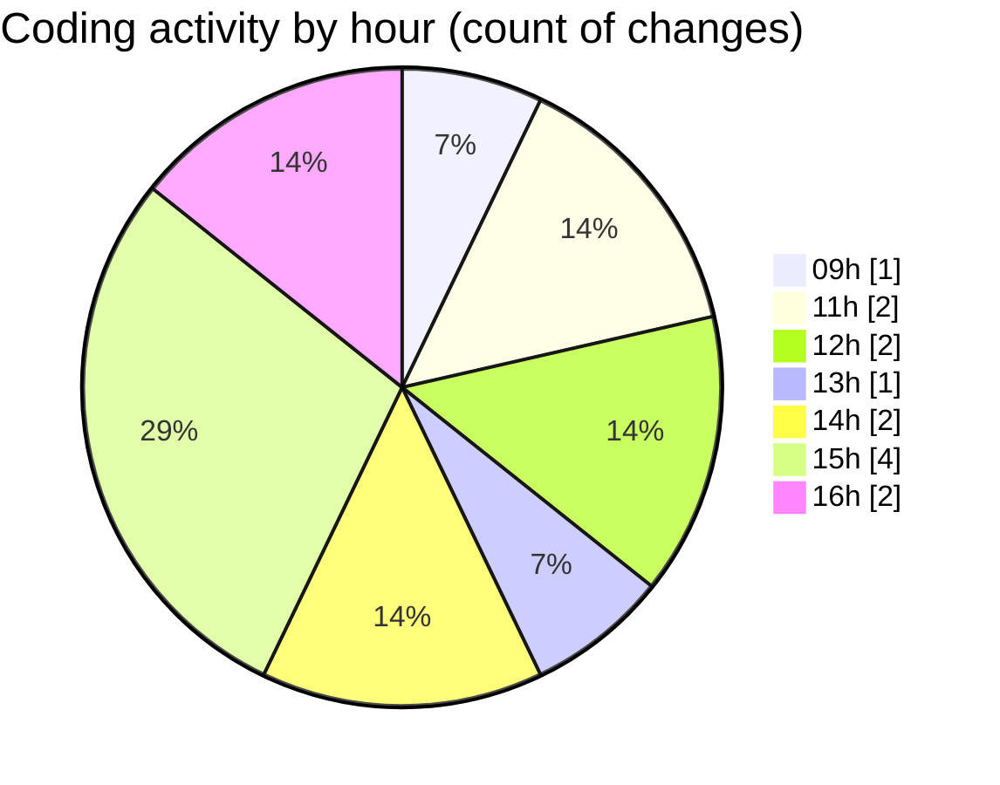

# CILApp - Activity Summary 

## Overall Statistics

| Stat                   | Value                                                             |
| ---------------------- | ----------------------------------------------------------------- |
| **Lines Added** (➕)   | 15172                                          |
| **Lines Removed** (➖) | 9                                        |
| **Net Change** (↕)    | 15163                |
| **Active Time** (⌚)   | 10 minutes |

## Modified Files
- **PresentacionMonitorios.java** (+10764, -9)
- **cartas_resto_2026-11-17_2.backup** (+51, -0)
- **cartas_resto_2026-11-17_2.dat** (+51, -0)
- **ProcMonitorioToMASC.java** (+1839, -0)
- **launch.json** (+1426, -0)
- **MascSmsService.java** (+1041, -0)

## Visualizations

### By File Type (Lines Changed)

### By Hour (Estimated Activity Count)

> **Last Updated:** 11/19/2026, 4:04:31 PM