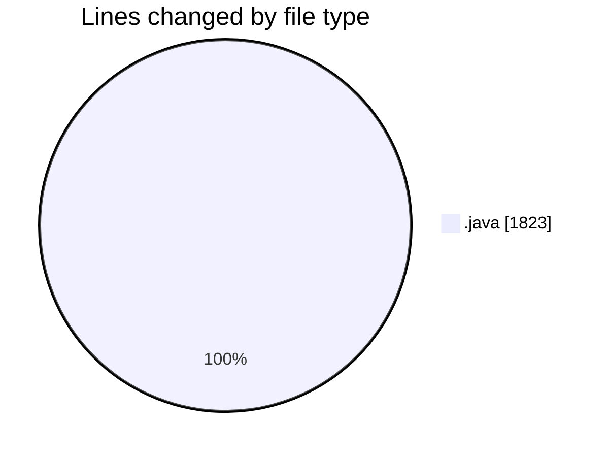
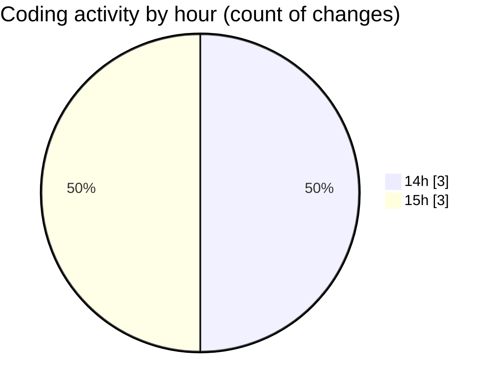

# CILReports (Workspace) - Activity Summary 

## Overall Statistics

| Stat                   | Value                                                             |
| ---------------------- | ----------------------------------------------------------------- |
| **Lines Added** (➕)   | 1823                                          |
| **Lines Removed** (➖) | 0                                        |
| **Net Change** (↕)    | 1823                |
| **Active Time** (⌚)   | 7 minutes |

## Modified Files
- **IF2DistributionRestController.java** (+483, -0)
- **DistributionDocumentationServiceImpl.java** (+883, -0)
- **IF2DistributionRepository.java** (+457, -0)

## Visualizations

### By File Type (Lines Changed)

### By Hour (Estimated Activity Count)

> **Last Updated:** 11/27/2026, 3:16:49 PM